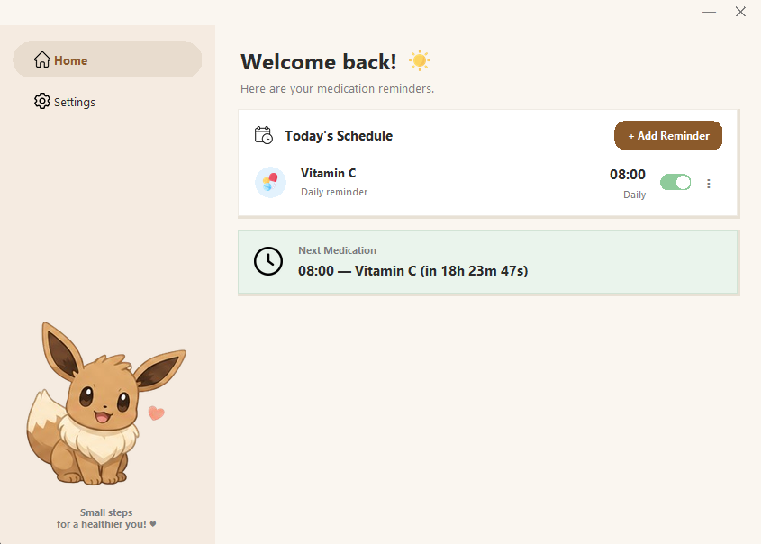
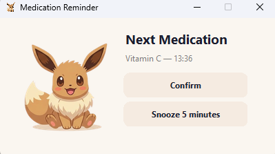

# Eevee Reminder

  

  
  
  
  

## About the Project

The goal of this project is to develop a simple Windows application that helps users remember to take their medications at the correct times.

The application will run in the background and monitor the system clock. When a scheduled time is reached, it will display a visual notification and play an alert sound to attract the user's attention.

This project was created both as a software development exercise and as a practical tool to assist with medication schedules that require regular reminders.

In addition to addressing a real-world need, the project serves as an opportunity to study programming concepts such as graphical user interfaces, file handling, time management, and Windows application deployment.

This is a personal project intended for learning and personal use.

---

## Technology Stack

### Programming Language

* Python

### Planned Libraries

* **tkinter** – Graphical user interface (GUI).
* **datetime** – Date and time management.
* **json** – Configuration storage.
* **winsound** – Sound playback on Windows.
* **threading** – Background task execution.
* **pystray** – System tray integration, allowing the application to run in the background and provide quick access through a tray icon.
* **pillow** - Image processing and manipulation library used for loading, displaying, and managing application assets and tray icons.
* **pyinstaller** – Generation of a standalone `.exe` file.

---

## Screenshots

  
  

